<div align="center">

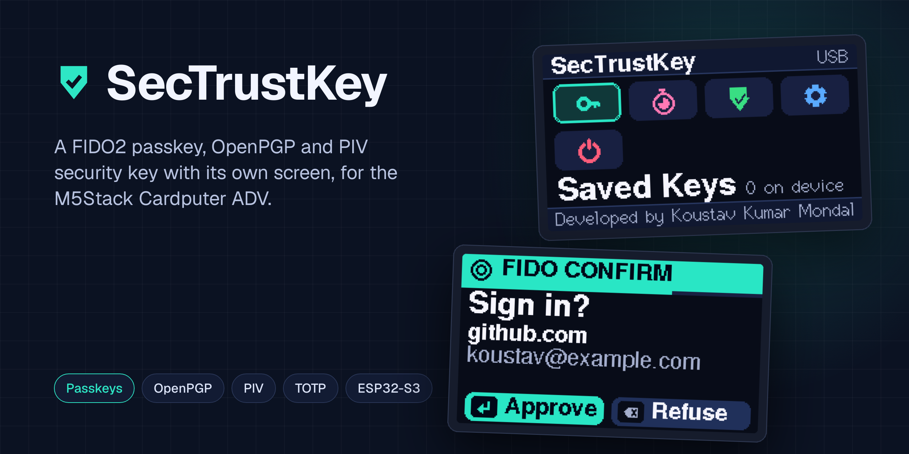

# SecTrustKey

**Open-source FIDO2 passkey, OpenPGP, PIV and TOTP security key firmware for the M5Stack Cardputer ADV (ESP32-S3)**

[](https://github.com/TakMashhido/SecTrustKey/releases/latest)
[](LICENSE)
[](https://docs.m5stack.com/)
[](https://github.com/espressif/esp-idf)
[](https://koustavmondal.com/SecTrustKey/)

[**Documentation**](https://koustavmondal.com/SecTrustKey/) &nbsp;|&nbsp;
[**Download**](https://github.com/TakMashhido/SecTrustKey/releases/latest) &nbsp;|&nbsp;
[**Install**](https://koustavmondal.com/SecTrustKey/getting-started/install/) &nbsp;|&nbsp;
[**User guide**](https://koustavmondal.com/SecTrustKey/guide/) &nbsp;|&nbsp;
[**Architecture**](https://koustavmondal.com/SecTrustKey/concepts/architecture/)

</div>

---

**SecTrustKey** turns a pocket-sized M5Stack Cardputer ADV into a hardware security key that shows you what it is about to sign. Plug it in and it works as a **passkey and FIDO2/U2F key** in every major browser, an **OpenPGP card** for GnuPG, SSH and Git signing, a **PIV smart card**, and an **authenticator with live TOTP codes on its own display**. Every request appears on the screen with the website and account; nothing happens until you press <kbd>Enter</kbd>.

## See it in action

<table>
  <tr>
    <td width="50%"></td>
    <td width="50%">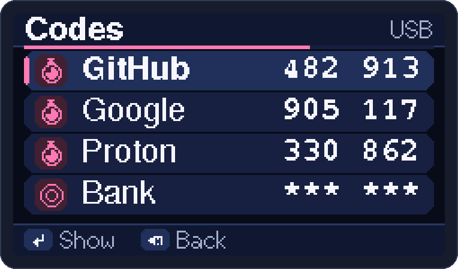</td>
  </tr>
  <tr>
    <td align="center"><b>Approve on the device.</b> The site and account are on the screen, not hidden in a browser dialog.</td>
    <td align="center"><b>Codes on the screen.</b> TOTP codes with a countdown; touch-only accounts stay hidden.</td>
  </tr>
  <tr>
    <td>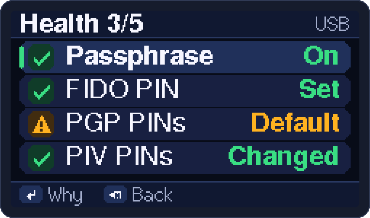</td>
    <td>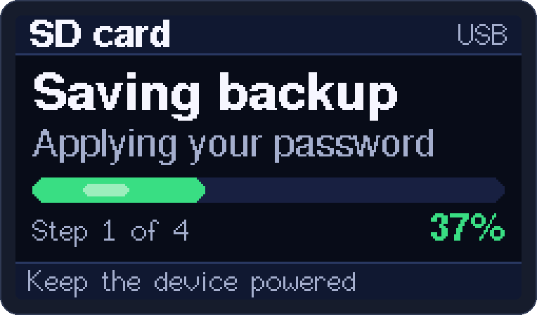</td>
  </tr>
  <tr>
    <td align="center"><b>Health check.</b> Flags factory PINs, a missing FIDO PIN, passphrase or backup.</td>
    <td align="center"><b>Encrypted SD backup.</b> Verified twice; a failed backup never replaces a good one.</td>
  </tr>
  <tr>
    <td>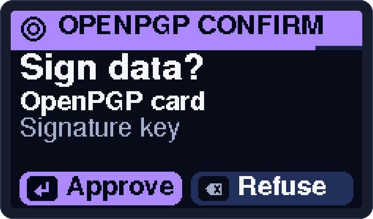</td>
    <td>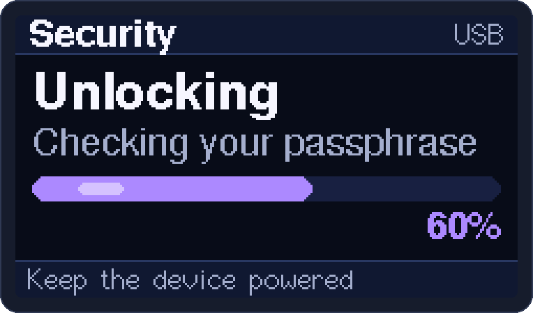</td>
  </tr>
  <tr>
    <td align="center"><b>OpenPGP confirm.</b> Signing, decryption and SSH login can each require a key press.</td>
    <td align="center"><b>Startup passphrase.</b> Keys stay encrypted at rest until you unlock them.</td>
  </tr>
</table>

<details>
<summary><b>More screens</b></summary>
<br>

| | | |
|:-:|:-:|:-:|
| 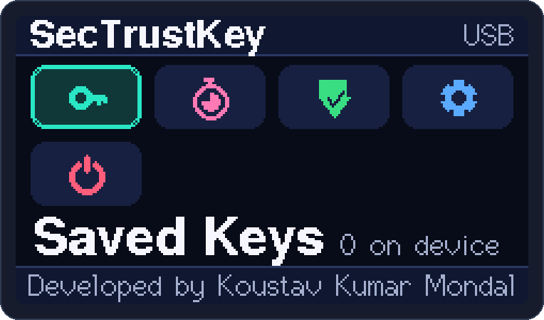 | 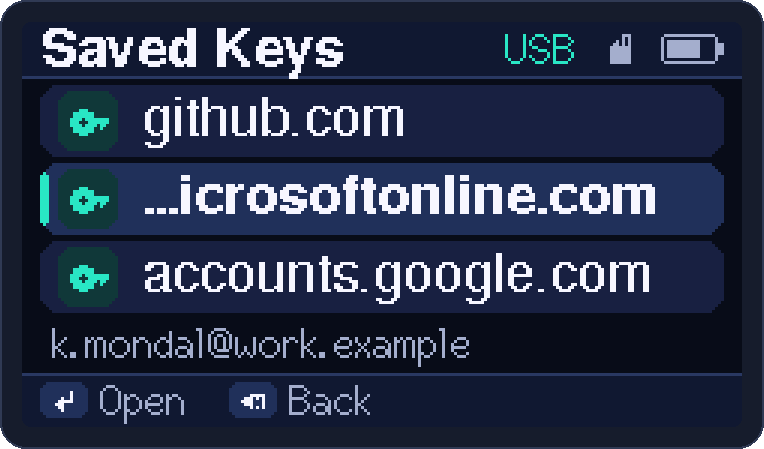 |  |
| Home | Saved passkeys | Create a passkey |
| 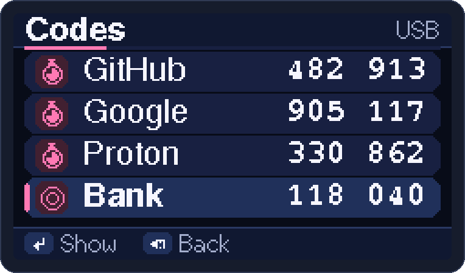 | 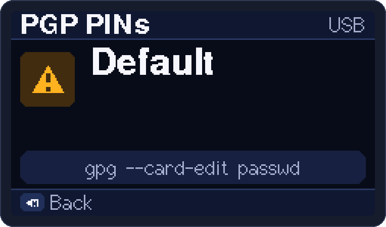 | 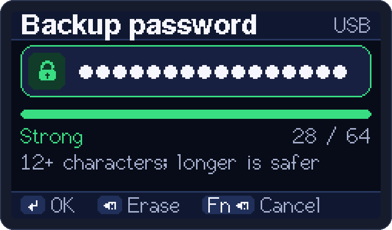 |
| Touch-only code hidden | Health advice | Password with strength meter |
| 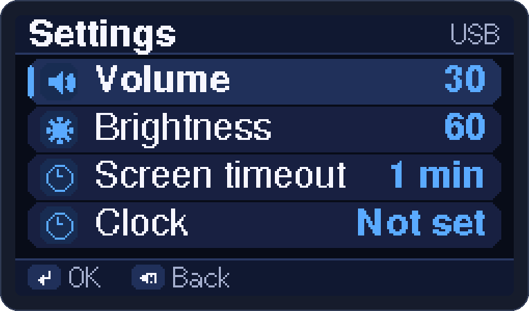 | 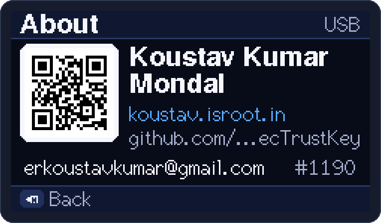 | 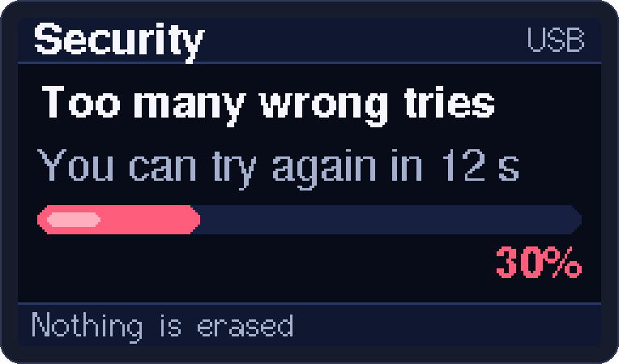 |
| Settings | About | Wrong tries add delays, never wipe |

</details>

> Screens are rendered by the firmware's own drawing code on a computer; the real LCD looks the same, with its own colour and viewing angle.

## Features

| | Feature | Details |
|:-:|---|---|
| 🔑 | **Passkeys and FIDO2** | CTAP 2.0 to 2.3 and U2F. Ed25519, ES256, ES384, ES512. Resident keys, credential management, `hmac-secret`, `credProtect`, large blobs, FIDO PIN |
| ✍️ | **OpenPGP card** | Keys generated on the device: Ed25519/X25519, RSA 2048 to 4096, NIST P-256/384/521, secp256k1, Brainpool. Works with `gpg`, `ssh` and Git signing |
| 🪪 | **PIV card** | Standard slots, PIN, PUK and management key; works with `ykman` and OpenSC |
| ⏱️ | **TOTP on screen** | OATH accounts shown live with a countdown; touch accounts reveal on <kbd>Enter</kbd>; HOTP and Yubico OTP too |
| 🕒 | **Sets its own clock** | Settings → Clock: sync over Wi-Fi or type the time, with your time zone. No computer script needed; Wi-Fi stays off while the key is in use |
| 🐧 | **Linux login** | `pam_u2f` and `pamu2fcfg` work out of the box, including the older versions in Ubuntu 24.04 and Debian 12 |
| 🔒 | **Startup passphrase** | Master keys encrypted at rest with PBKDF2-SHA256 and AES-256-GCM; wrong tries only add delays, nothing is erased |
| 💾 | **Encrypted SD backup** | Back up, verify and restore the whole key store; PBKDF2 at 600,000 rounds, AES-256-GCM, kept in a `SecTrustKey` folder |
| 🩺 | **Health check** | Scores your setup without spending a PIN try and tells you how to fix each item |
| 🚀 | **M5 Launcher ready** | Install and update from Launcher next to other apps; one image also flashes with esptool or M5Burner |
| 🧩 | **Your own USB identity** | Vendor ID, product ID, manufacturer and product name set at build time |

## Install in two minutes

Download `sectrustkey-v1.2.0-cardputer-adv.bin` from the [latest release](https://github.com/TakMashhido/SecTrustKey/releases/latest). The same file works three ways:

| | How |
|---|---|
| **M5 Launcher** | Copy the file to the SD card, then in Launcher open **SD**, select it and **Install**. SecTrustKey sits next to your other apps. [Guide](https://koustavmondal.com/SecTrustKey/getting-started/launcher/) |
| **esptool** | Download mode (power off, hold **G0**, plug in USB, release **G0**), then the command below. Replaces everything on the chip. |
| **Browser** | Espressif's [browser flasher](https://espressif.github.io/esptool-js/): connect, **Erase Flash**, then program the file at `0x0`. |

```sh
pip install esptool
esptool.py --chip esp32s3 --baud 921600 write_flash --erase-all 0x0 sectrustkey-v1.2.0-cardputer-adv.bin
```

On the first start the device may ask **Set up storage?**; press <kbd>Enter</kbd>. Then [secure the device](https://koustavmondal.com/SecTrustKey/getting-started/first-steps/): change the factory PINs, set a FIDO PIN, and consider a startup passphrase.

> [!CAUTION]
> In M5 Launcher, **never delete a SecTrustKey entry** unless you mean to erase your keys: Launcher removes the key storage together with the app. To update, just install the new file; it shares the same keys.

<details>
<summary><b>Build from source</b></summary>
<br>

Only Docker is needed; the build runs in the pinned ESP-IDF v5.5.3 container.

```sh
git clone https://github.com/TakMashhido/SecTrustKey.git
cd SecTrustKey
scripts/in-container.sh bash scripts/build.sh
# with your own USB identity:
scripts/in-container.sh bash scripts/build.sh -DUSB_VID=0x1209 -DUSB_PID=0x0001 "-DUSB_PRODUCT=My Key"
# the single image for esptool, M5Burner and M5 Launcher:
scripts/in-container.sh bash scripts/make-image.sh
```

The images are written to `build/cardputer-adv/`. See [Build from source](https://koustavmondal.com/SecTrustKey/getting-started/build/).

</details>

## How it works

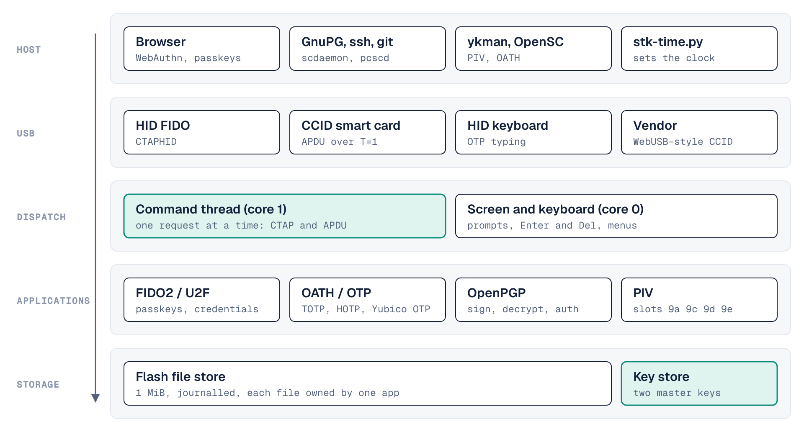

One firmware presents four USB interfaces. Every request runs on a single command thread in the right application, and anything sensitive waits for you on the screen:

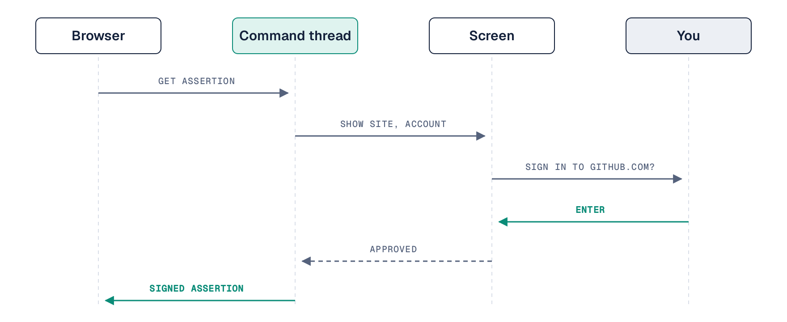

With a startup passphrase, the keys stay sealed until you unlock them on the device, before USB even starts:

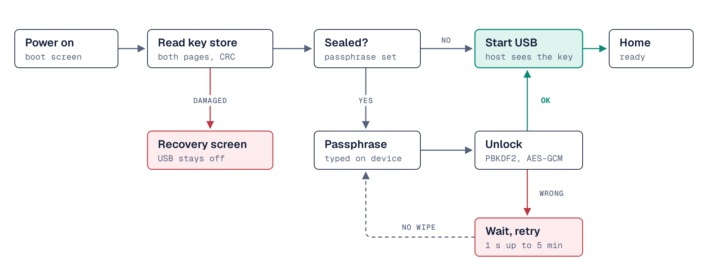

More in [Architecture](https://koustavmondal.com/SecTrustKey/concepts/architecture/), [Storage and key store](https://koustavmondal.com/SecTrustKey/concepts/storage/) and [Boot and unlock](https://koustavmondal.com/SecTrustKey/concepts/boot/).

## Security

> [!WARNING]
> The ESP32-S3 is a microcontroller, not a certified secure element. Secure Boot and flash encryption are deliberately not enabled, so without a startup passphrase anyone who can read the chip's flash can copy the keys. Keep a second authenticator on every account that matters, and read the [security model](https://koustavmondal.com/SecTrustKey/concepts/security/).

Report security problems privately to **koustav@koustavmondal.com**.

## Documentation

| Start here | Use it | Understand it |
|---|---|---|
| [Install from a release](https://koustavmondal.com/SecTrustKey/getting-started/install/) | [Passkeys](https://koustavmondal.com/SecTrustKey/guide/passkeys/) | [Architecture](https://koustavmondal.com/SecTrustKey/concepts/architecture/) |
| [Build from source](https://koustavmondal.com/SecTrustKey/getting-started/build/) | [OpenPGP and GnuPG](https://koustavmondal.com/SecTrustKey/guide/openpgp/) | [Security model](https://koustavmondal.com/SecTrustKey/concepts/security/) |
| [First steps](https://koustavmondal.com/SecTrustKey/getting-started/first-steps/) | [TOTP codes](https://koustavmondal.com/SecTrustKey/guide/codes/) | [Custom USB identity](https://koustavmondal.com/SecTrustKey/customize/usb-identity/) |
| [Troubleshooting](https://koustavmondal.com/SecTrustKey/troubleshooting/) | [SD backup](https://koustavmondal.com/SecTrustKey/guide/backup/) | [Flash layout](https://koustavmondal.com/SecTrustKey/reference/flash-layout/) |

## License and credits

Copyright (c) 2026 [Koustav Kumar Mondal](https://koustavmondal.com/). Licensed under the [GNU Affero General Public License v3.0](LICENSE); see [NOTICE.md](NOTICE.md) for incorporated software and changes.

SecTrustKey builds on [Pico FIDO](https://github.com/polhenarejos/pico-fido), [Pico OpenPGP](https://github.com/polhenarejos/pico-openpgp) and the [Pico Keys SDK](https://github.com/polhenarejos/pico-keys-sdk) by Pol Henarejos, and on the [Cardputer ADV port](https://github.com/lessucettes/cardputer-fido-adv) by lessucettes.
