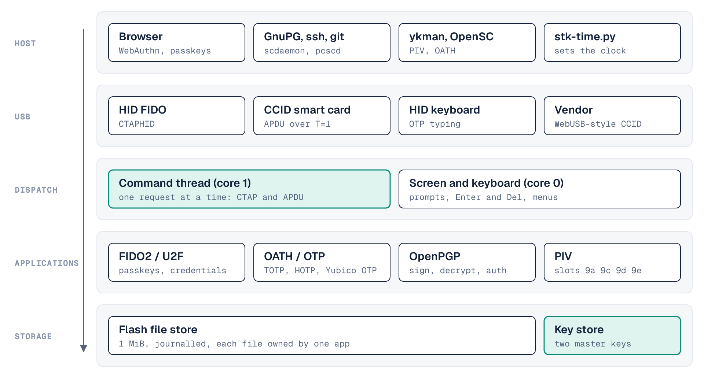
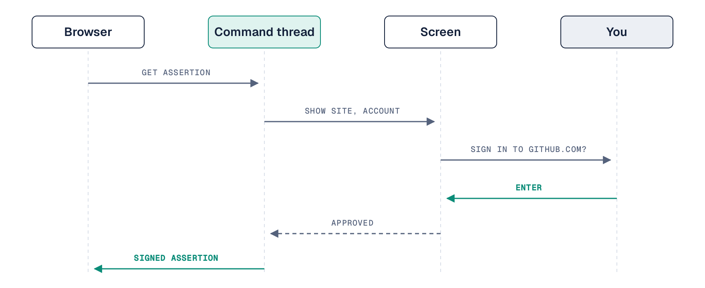

# Architecture

SecTrustKey is one ESP-IDF firmware that presents several security applications over a single USB connection, keeps all of their data in one flash file store, and asks a person on the device's screen before any key is used.

<figure markdown>
{ .stk-diagram }
<figcaption>Requests flow down: a host program sends a command over one of the USB interfaces, the command thread runs it in the right application, and the application reads or writes its files. The master keys in the key store protect what the file store holds.</figcaption>
</figure>

## One device, three code bases

The firmware merges three upstream projects into one device: FIDO2/U2F with OATH and Yubico OTP ([Pico FIDO](https://github.com/polhenarejos/pico-fido)), the OpenPGP card and PIV ([Pico OpenPGP](https://github.com/polhenarejos/pico-openpgp)), on the [Pico Keys SDK](https://github.com/polhenarejos/pico-keys-sdk). They share one USB device and one file store.

Each file belongs to exactly one application, and every destructive command (FIDO reset, OpenPGP `TERMINATE DF`, PIV reset) is limited to its own files, so resetting one application never touches the others.

## Cores and tasks

| Task | Core | Job |
|---|---|---|
| TinyUSB | 1 | USB endpoints; receives commands and starts the command thread |
| Command thread | 1 | Runs one CTAP or APDU command at a time in the selected application |
| Main loop | 0 | HID and CCID framing, responses and keep-alives, flash commits, the user interface |

Switching between the FIDO interface and the smart-card interface stops the command thread and starts a new one for the other interface. Starting it is retried for up to a second, because the stopped thread's memory is released a moment later.

## Confirming a request

<figure markdown>
{ .stk-diagram }
<figcaption>While the prompt is open, the device sends keep-alive messages so the browser keeps waiting.</figcaption>
</figure>

A prompt ends only when you press ++enter++ or ++backspace++, its timeout runs out, the host cancels that request, or the cable is unplugged. The Cardputer has no USB power-sense line, so "unplugged" means more than 500 ms without USB start-of-frame packets.

## Source layout

| Folder | Contents |
|---|---|
| `apps/fido` | FIDO2/U2F, OATH, Yubico OTP, management, the on-screen TOTP view |
| `apps/openpgp`, `apps/piv` | OpenPGP card and PIV, with the cross-application isolation rules |
| `platform` | USB (TinyUSB, HID, CCID), APDU dispatch, flash file system, vault, random numbers |
| `board` | Cardputer ADV: display, keyboard, user interface, key store, passphrase sealing, SD backup |
| `config` | Partition tables and ESP-IDF settings |
| `scripts` | `build.sh` and `in-container.sh` |
