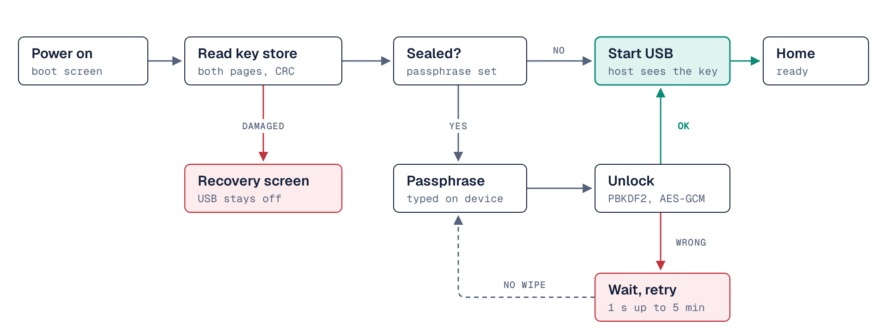

# Boot and unlock

<figure markdown>
{ .stk-diagram }
<figcaption>USB starts only once the keys are available and healthy, so a computer never sees a half-ready key.</figcaption>
</figure>

1. **Power on.** The boot screen appears while the display, keyboard and storage start.
2. **Read the key store.** Both pages are read and checked; the newest valid record wins. A fresh device creates its master keys here.
3. **Sealed?** Without a passphrase, USB starts and the home screen appears.
4. **Passphrase.** With a passphrase, the device asks for it on its own keyboard. The key is derived with PBKDF2 and the record is opened with AES-256-GCM.
5. **Wrong passphrase.** Nothing is erased. After the third wrong try the device waits 1 s, then 2 s, 4 s … up to 5 minutes before the next one, and the count survives power cycles.
6. **Damaged storage.** If the key store or file store cannot be read safely, the device opens a recovery screen and keeps USB off. Restore an [SD backup](../guide/backup.md), or erase and reflash.
