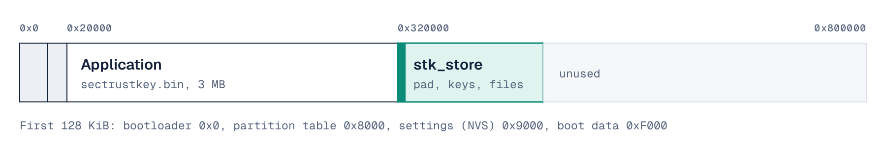

# Storage and key store

<figure markdown>
{ .stk-diagram }
<figcaption>An application update writes only from 0x20000; the key store at 0x320000 is never touched by it.</figcaption>
</figure>

## Key store

The key storage partition, `stk_store`, starts with a 4 KiB **installer pad**: the firmware image carries it, so installers such as M5 Launcher create the partition at full size and rewrite only that sector on every install and update. The firmware never reads or writes the pad. (Devices installed with v1.0 use a `fido_store` partition without the pad, which is still supported.)

After the pad come two mirrored 4 KiB pages. Each holds a record with the device's two **master keys**:

- one wraps the stored secrets;
- the other is a secp256k1 scalar from which per-application keys are derived.

Each record carries a CRC, a commit marker and a **generation number**. Two formats exist:

| Record | Contents |
|---|---|
| `CFKEY001` | Plain master keys (no passphrase) |
| `CFKEY002` | Sealed: PBKDF2 cost, 16-byte salt, 12-byte nonce, the master keys encrypted with AES-256-GCM and its tag; the header is authenticated |

## File store

The remaining 1 MiB is a journalled flash file system holding every application's data. Secrets in it are encrypted under keys derived from the master keys; OpenPGP and PIV private keys are further protected by their PINs.

File identifiers are partitioned between applications (OpenPGP key containers use `0xF0xx` to `0xF5xx`, for example), so a reset can delete exactly one application's files.

## Power-cut safety

Changing the key store always writes the page that does **not** hold the current record first, verifies it, and only then overwrites the other page. At start-up the valid record with the highest generation wins; two different records with the same generation are treated as damage rather than guessed between.

So whenever power is lost, the device comes back with either the old or the new state, never neither. A plaintext copy left behind by an interrupted sealing is overwritten at the next unlock.

The [SD backup](../guide/backup.md) follows the same rule: a new backup is written to a temporary file, verified, and only then renamed over the latest one, whose previous version is kept.
