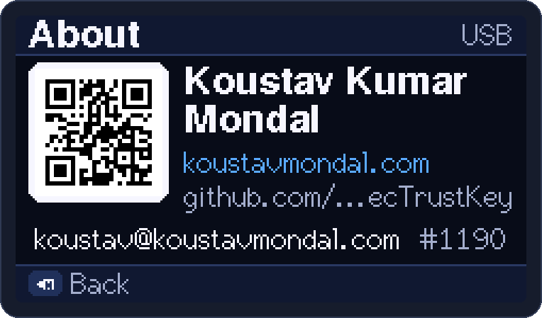
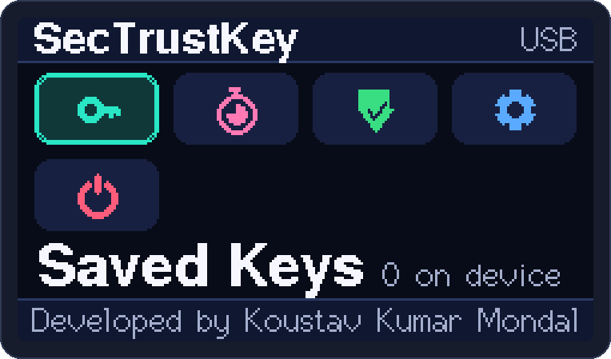

# About page and credit

<div class="stk-screens" markdown>
<figure markdown>

<figcaption>Settings › About</figcaption>
</figure>
<figure markdown>

<figcaption>The credit line on the home screen</figcaption>
</figure>
</div>

**Settings › About** shows a QR code, the developer's name, website, e-mail address, GitHub link and the firmware build. The home screen carries a credit line. All of them are in one header, `board/about.h`:

```cpp
inline constexpr const char* kAboutName = "Koustav Kumar Mondal";
inline constexpr const char* kAboutWebsite = "koustavmondal.com";
inline constexpr const char* kAboutEmail = "koustav@koustavmondal.com";
inline constexpr const char* kAboutRepo = "github.com/TakMashhido/SecTrustKey";
inline constexpr const char* kAboutQr = "https://koustavmondal.com";
inline constexpr const char* kCredit = "Developed by Koustav Kumar Mondal";
```

The QR code is generated on the device from `kAboutQr`; keep it short so the code stays readable at 60 pixels.

!!! info "Licence"
    SecTrustKey is licensed under the AGPL v3.0. If you distribute a modified version, keep the licence and the existing copyright notices, mark your changes, and offer the source of your version.
