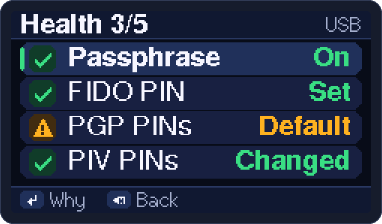

# First steps

A freshly flashed SecTrustKey works immediately, but its OpenPGP and PIV PINs are the **public factory values**. Work through this list before you store anything real. The **Health** tile on the device ticks most of it off as you go.

- [ ] **Change the OpenPGP PINs.** User PIN `123456` (6+ characters) and admin PIN `12345678` (8+ characters). [How →](../guide/openpgp.md#change-the-pins)
- [ ] **Change the PIV secrets.** PIN `123456`, PUK `12345678` and the management key. [How →](../guide/piv.md)
- [ ] **Set a FIDO PIN.** There is none until you set one. [How →](../guide/passkeys.md#set-a-fido-pin)
- [ ] **Decide on a startup passphrase.** It encrypts the keys at rest, and the device asks for it at every power-up. [How →](../guide/passphrase.md)
- [ ] **Make and verify an SD backup**, and keep its password somewhere other than the card. [How →](../guide/backup.md)
- [ ] **Register a second authenticator** for every account that matters, so losing one device never locks you out.

<figure markdown>

<figcaption>Health shows what is still left to do</figcaption>
</figure>
<figure markdown>

<figcaption>Press Enter on a line to see how to fix it</figcaption>
</figure>

## Linux: one-time setup

=== "FIDO2"

    Nothing to do. systemd recognises FIDO security keys by their HID usage, whatever their USB ID, and gives your desktop session access.

=== "OpenPGP and PIV"

    `pcscd` uses the CCID driver's list of known readers. Add SecTrustKey's ID once, as described in [OpenPGP and GnuPG](../guide/openpgp.md#linux-let-pcscd-see-the-reader), then restart `pcscd`.

## Try it

Register the key on a test page such as [webauthn.io](https://webauthn.io/): choose **Register**, and the device shows **Create passkey?** with the site and user name. Press <kbd>Enter</kbd> to approve or <kbd>Del</kbd> to refuse.
