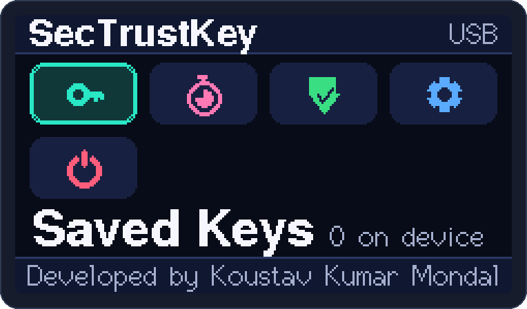
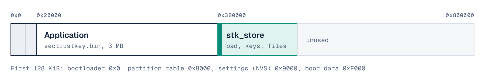

# Install with M5 Launcher or M5Burner

The release image `sectrustkey-vX.Y.Z-cardputer-adv.bin` works with [M5 Launcher](https://github.com/bmorcelli/Launcher), M5Burner and esptool alike. With Launcher, SecTrustKey sits next to your other apps and keeps its keys when you switch between them or update it.

## Install from M5 Launcher

1. Copy `sectrustkey-vX.Y.Z-cardputer-adv.bin` to the SD card. With Launcher running, its **USB** menu item shares the card with your computer as a drive.
2. In Launcher, open **SD**, select the file and choose **Install**.
3. SecTrustKey starts. If it shows **Set up storage?** ("No SecTrustKey keys here yet"), press ++enter++, then ++enter++ again on **Storage ready**.

<figure class="stk-screen-one" markdown>

</figure>

To come back to Launcher, switch the Cardputer off and on and press **Enter** on Launcher's start screen. To start SecTrustKey again, pick it in Launcher's list of apps.

!!! note "Why it may ask to set up storage"
    Launcher creates SecTrustKey's storage area (a 1 MB partition called `stk_store`) in free flash, which can still hold another app's old data. SecTrustKey never erases anything on its own: it asks once, and only offers this for an area that has never held SecTrustKey keys.

## Update from M5 Launcher

Install the new file the same way. Launcher adds it as another SecTrustKey entry that **uses the same storage**, so your passkeys and other keys are kept. Start the newest entry; older ones can stay. When flash runs out, Launcher asks where to install: choose **Use … partition** on an older SecTrustKey entry to replace it in place.

!!! danger "Never delete a SecTrustKey entry in Launcher"
    Deleting an app in Launcher also deletes the data partition installed with it. For SecTrustKey that is the key storage shared by every SecTrustKey entry, so **all your keys are erased** (Launcher asks *Delete … + SPIFFS?* first). Make an [encrypted SD backup](../guide/backup.md) before removing SecTrustKey from Launcher.

Deleting **other** apps is safe: Launcher moves partitions to close gaps and copies their contents, including SecTrustKey's storage.

## Flash with M5Burner

M5Burner writes the whole file at address `0x0` and replaces everything on the chip, Launcher included. Pick SecTrustKey in M5Burner's list for the Cardputer, or add the downloaded file as a custom firmware, and **Burn**. If the flash was not erased first, the device asks **Set up storage?** on the first start; press ++enter++.

## How the storage survives

{ .stk-diagram }

The image's partition table declares `stk_store` as a data partition of 1,036 KB. Its first 4 KB is an **installer pad** that ships inside the image; the two key pages and the 1 MB file system follow it and are never part of any image.

| Launcher action | What happens to `stk_store` |
|---|---|
| First install | Created at the declared size; only the pad is written |
| Update (install again) | Found by its name and reused; only the pad is rewritten |
| Install, run or delete another app | Kept; moved with its contents if Launcher compacts the flash |
| Delete a SecTrustKey entry | **Removed and erased**, see above |
| Partition manager: format or delete | Erased, if you choose to |

Devices installed with v1.0 keep their original `fido_store` partition and update normally with esptool.

!!! info "Launcher's own data backup"
    When deleting an app, Launcher can copy its data partition to the SD card and restore it on reinstall. For SecTrustKey that is a raw copy of the key storage: without a [startup passphrase](../guide/passphrase.md) it contains the master keys unencrypted. Prefer SecTrustKey's own encrypted [SD backup](../guide/backup.md).

These results come from Launcher 3.0 on a Cardputer ADV: install from SD, register a passkey, install and run another app, update, delete the other app, and sign in with the same passkey after each step.
