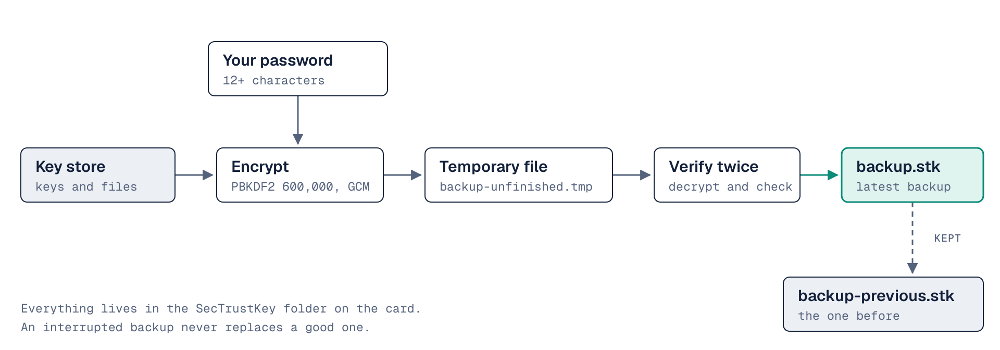
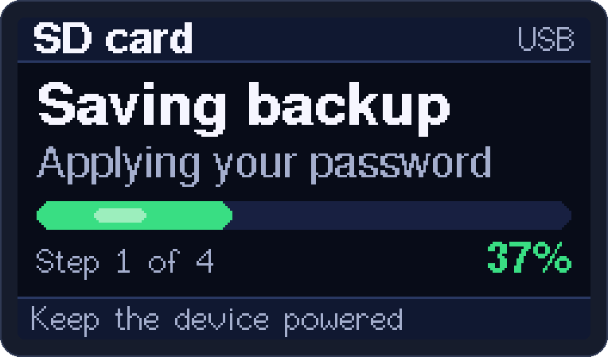

# SD backup and restore

The tools under **Settings › Security & Backup** save the **whole key store** (passkeys, OpenPGP, PIV and OATH data and the master keys) to a microSD card, encrypted with a password you choose.

{ .stk-diagram }

## The tools

| Tool | What it does |
|---|---|
| **Backup to SD** | Encrypts the key store with a password of 12+ characters into `backup.stk`, keeps the previous backup as `backup-previous.stk`, and checks the new file twice. |
| **Restore from SD** | Checks the whole file and your password before writing anything, then replaces the device's keys. |
| **Verify backup** | Decrypts and checks a backup without changing anything. |
| **SD card info** | Free space and which backup files are present. |

Each tool restarts the device into a maintenance screen with USB off, and shows its steps and progress. Deriving the key from your password takes about half a minute on this chip.

<figure class="stk-screen-one" markdown>

</figure>

## Files on the card

Everything lives in a `SecTrustKey` folder, created automatically. The card is never formatted.

| File | Meaning |
|---|---|
| `SecTrustKey/backup.stk` | The latest verified backup |
| `SecTrustKey/backup-previous.stk` | The one before it |
| `SecTrustKey/backup-unfinished.tmp` | A backup in progress; it only replaces `backup.stk` after it has been verified |

Files from earlier versions (`FIDOBAK.CFB`, `.OLD`, `.TMP` in the card's root) are moved into the folder automatically.

## Encryption

| | |
|---|---|
| Key derivation | PBKDF2-HMAC-SHA256, 600,000 iterations, random salt |
| Cipher | AES-256-GCM in 4 KiB authenticated chunks |
| Binding | A backup can only be restored on the device that made it |

## Good to know

- Restoring returns the PIN retry counters and signature counters to their values at the time of the backup.
- A backup made while a startup passphrase was set needs that passphrase after the restore.
- Keep the backup password somewhere other than on the card, and verify a backup now and then.
