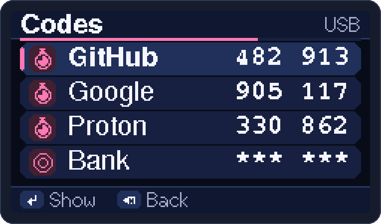
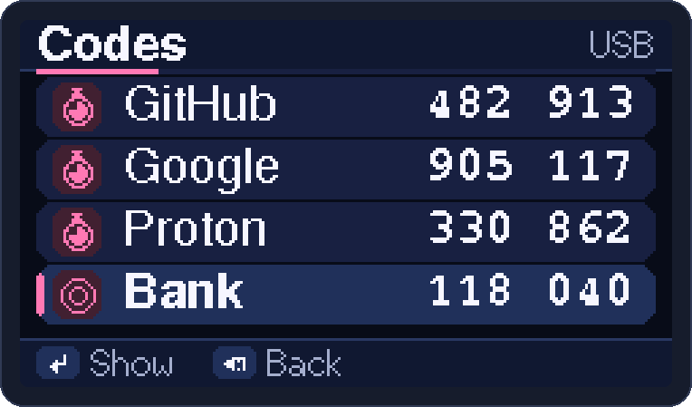

# TOTP codes on the screen

SecTrustKey's OATH application stores TOTP and HOTP accounts, like a YubiKey. Unlike a YubiKey, it can **show the codes on its own screen**.

<div class="stk-screens" markdown>
<figure markdown>

<figcaption>Codes with a countdown for the 30-second step</figcaption>
</figure>
<figure markdown>

<figcaption>Touch-only accounts stay hidden until Enter</figcaption>
</figure>
</div>

## Add accounts

Use any OATH client that talks to a YubiKey-compatible OATH application, for example `ykman` or Yubico Authenticator:

```bash
ykman --reader SecTrustKey oath accounts add --issuer GitHub koustav JBSWY3DPEHPK3PXP
ykman --reader SecTrustKey oath accounts add --touch --issuer Bank savings <SECRET>   # needs Enter to reveal
ykman --reader SecTrustKey oath accounts list
```

## Set the clock

The Cardputer has no battery-backed clock, so after every power-up **Codes** shows *Time not set* and no code is computed. Set the time from your computer with [`stk-time.py`](../assets/downloads/stk-time.py):

```bash
pip install pyscard
python3 stk-time.py
# clock set to 2026-11-22 10:20:00 UTC
```

The script needs `pcscd` and sends one command with the current Unix time; see [Clock tool](../reference/stk-time.md). Codes from `ykman oath accounts code` work without it, because the computer supplies the time.

## Reading codes

- Rows lead with the issuer, and the bar under the title counts down the current 30-second step.
- Move to a touch-only account and press ++enter++ to reveal it, for the current step only.
- HOTP accounts are listed but never computed on screen, since that would advance their counter.
- If the OATH application is protected with a password (`ykman oath access change`), codes are **not** shown on screen, because that would bypass the password.
