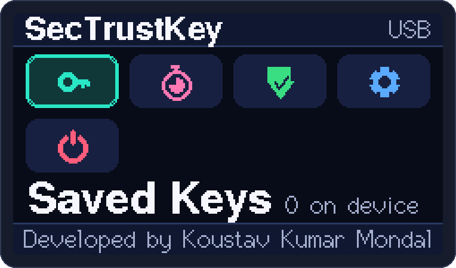
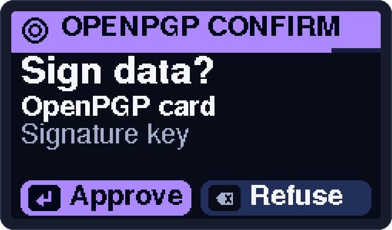
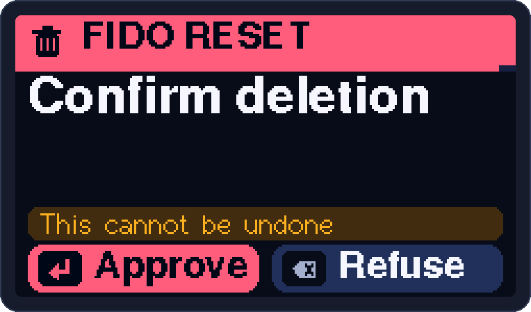
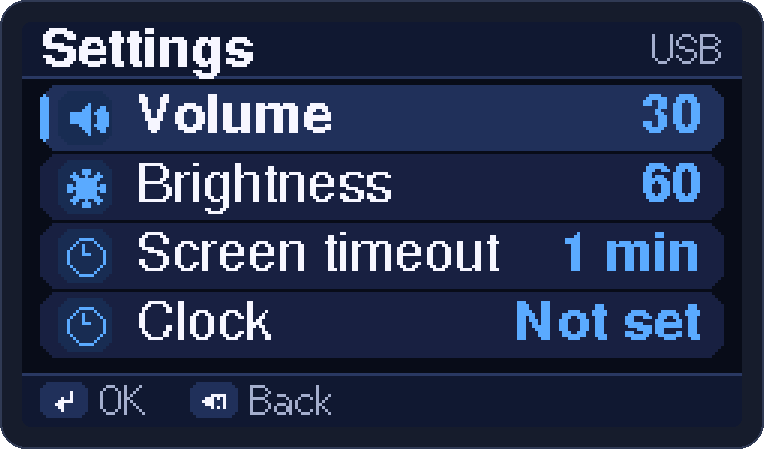

# Using the device

## Keys

| Key | What it does |
|---|---|
| ++semicolon++ ++period++ ++comma++ ++slash++ | Move up, down, left and right (the arrow keys printed on the Cardputer) |
| ++enter++ | Open, approve, reveal |
| ++backspace++ (Del) | Back, refuse |
| ++fn+backspace++ | Cancel a password entry |

## Home

<figure class="stk-screen-one" markdown>

</figure>

| Tile | What it opens |
|---|---|
| **Saved Keys** | Passkeys stored on the device; open one to see its account or delete it. |
| **Codes** | TOTP codes for the accounts stored on the device. See [TOTP codes](codes.md). |
| **Health** | A score of your setup with advice for each item. See [Health check](health.md). |
| **Settings** | Volume, brightness, screen timeout, Clock, Security & Backup, and About. |
| **Power Off** | Switches the device off cleanly. |

The status bar shows **USB** when a computer has configured the device, and the battery level.

## Confirmation prompts

When a computer asks for something that needs your consent, a full-screen prompt replaces whatever was showing. The coloured band tells you which application is asking:

<figure markdown>

<figcaption>FIDO, teal: sign in or create a passkey</figcaption>
</figure>
<figure markdown>

<figcaption>OpenPGP, violet: sign, decrypt or authenticate</figcaption>
</figure>
<figure markdown>

<figcaption>Destructive actions, red</figcaption>
</figure>

++enter++ approves and ++backspace++ refuses. A bar along the band counts down; when it runs out the request is refused. A prompt also closes if the computer cancels the request or the cable is unplugged.

!!! tip "Read the site name from the end"
    Long site names are shortened at the start and keep their end, so `paypal.com.evil.example` can never be shown as `paypal.com`.

## Settings

<figure class="stk-screen-one" markdown>

</figure>

| Setting | Options |
|---|---|
| Volume | 0 to 100, in steps of 10 |
| Brightness | 10 to 100, in steps of 10 |
| Screen timeout | 15 s, 30 s, 1 min, 2 min or never; any request wakes the screen |
| Clock | Wi-Fi sync, network, sync at start, typing the time, time zone ([details](codes.md#set-the-clock)) |
| Security & Backup | Passphrase, Backup to SD, Restore from SD, Verify backup, SD card info |
| About | Developer, website, contact, GitHub, firmware build |

Clock and the Security & Backup items restart the device into a maintenance screen with USB off, and show their progress.
