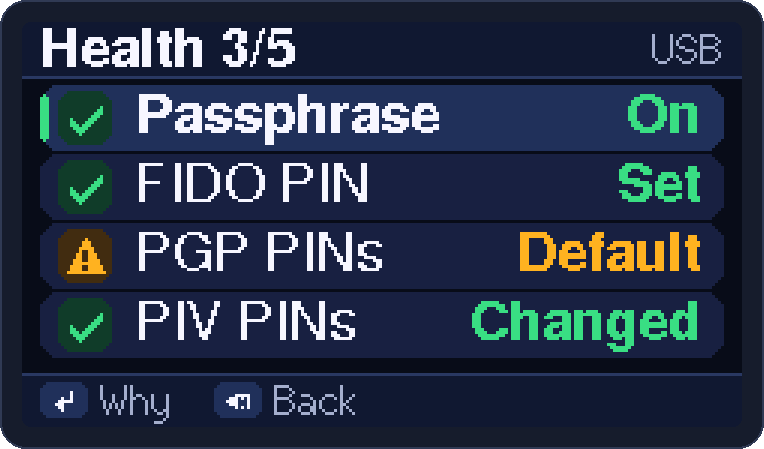
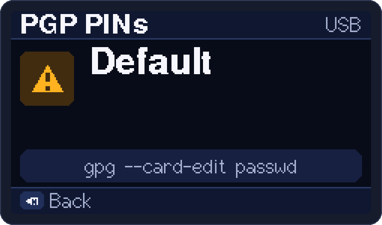

# Health check

The **Health** tile scores how well the device is set up. It never spends a PIN try: it compares the stored PIN verifiers with the public factory values.

<figure markdown>

<figcaption>The score and the five checks</figcaption>
</figure>
<figure markdown>

<figcaption>Enter on a line explains how to fix it</figcaption>
</figure>

| Check | Green when | How to fix |
|---|---|---|
| Passphrase | A startup passphrase encrypts the keys | [Startup passphrase](passphrase.md) |
| FIDO PIN | A FIDO PIN is set | [Set a FIDO PIN](passkeys.md#set-a-fido-pin) |
| PGP PINs | Neither the user nor the admin PIN is the factory value; the line says which one still is | [Change the PINs](openpgp.md#change-the-pins) |
| PIV PINs | Neither the PIN nor the PUK is the factory value | [PIV](piv.md#change-the-factory-secrets) |
| SD backup | A backup was saved and verified on this device | [SD backup](backup.md) |

Below the score, **Clock**, **Memory** (free heap, the largest free block, and how much of the screen task's stack is unused), uptime and the **Firmware** build are shown for information. If **Clock** reads *Unknown*, set it under **Settings → Clock**.
