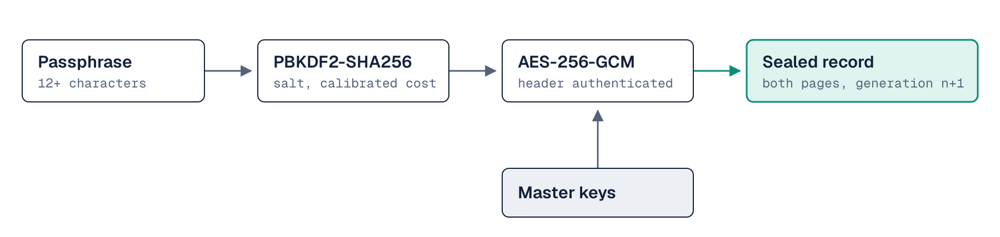
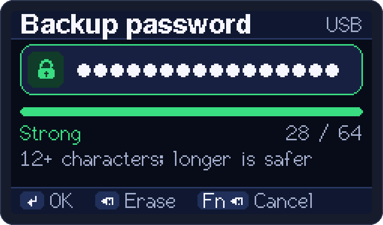
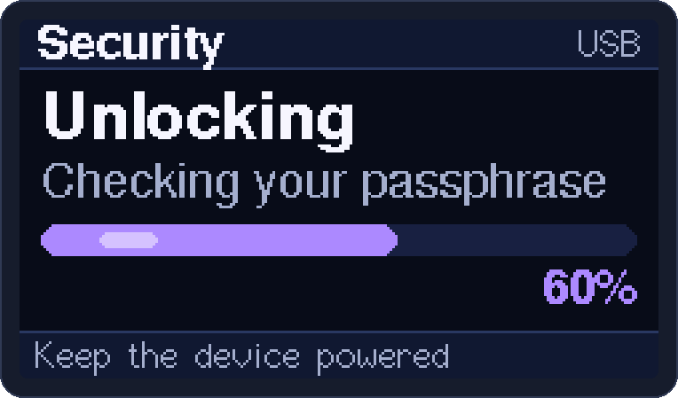

# Startup passphrase

**Settings › Security & Backup › Passphrase** encrypts the device's two master keys with a passphrase. Every stored key depends on them, so a copy of the flash is useless without the passphrase, and the device asks for it **on its own keyboard at every power-up, before USB starts**.

{ .stk-diagram }

## Turn it on

1. Choose **Passphrase**. The device restarts into a setup screen with USB off.
2. Type a passphrase of **12 or more characters**, twice. A meter shows its strength; four or more random words is a good choice.
3. Accept the warning: if you forget it, the keys are gone unless you have an [SD backup](backup.md).

<figure markdown>

<figcaption>The password entry with its strength meter (shown here for a backup)</figcaption>
</figure>
<figure markdown>

<figcaption>Unlocking at power-up</figcaption>
</figure>
<figure markdown>

<figcaption>Wrong tries only add a delay</figcaption>
</figure>

Unlocking takes about a second: the passphrase goes through PBKDF2-HMAC-SHA256 at a cost calibrated on the chip.

## Wrong passphrases

Wrong tries **never erase anything**, so nobody can destroy your keys by guessing.

| Wrong tries in a row | Wait before the next try |
|---|---|
| 1 or 2 | none |
| 3, 4, 5, 6 … | 1 s, 2 s, 4 s, 8 s … doubling |
| 12 and more | 5 minutes (the cap) |

The count is saved **before** each try is checked, so switching the device off does not reset it or give a free try.

## Change or remove it

Choose **Passphrase** again: the device offers **Change passphrase?** or **Remove passphrase?** and asks for the current one first. Removing it stores the master keys unencrypted again.

!!! info "What it protects"
    The passphrase protects a device that is **switched off**. Once unlocked, anyone holding the device can approve requests. See the [security model](../concepts/security.md).
