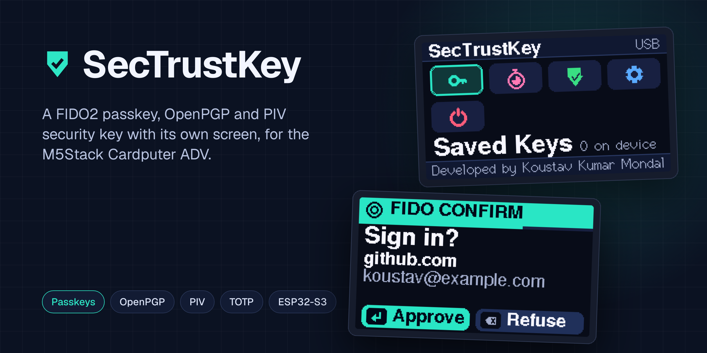
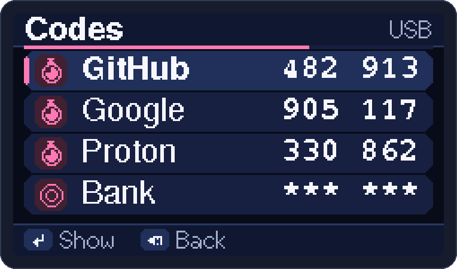
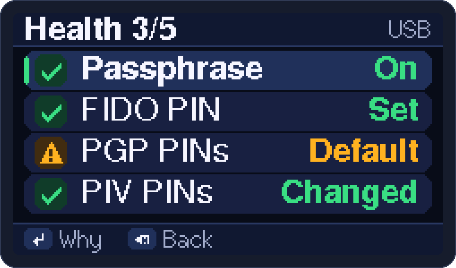
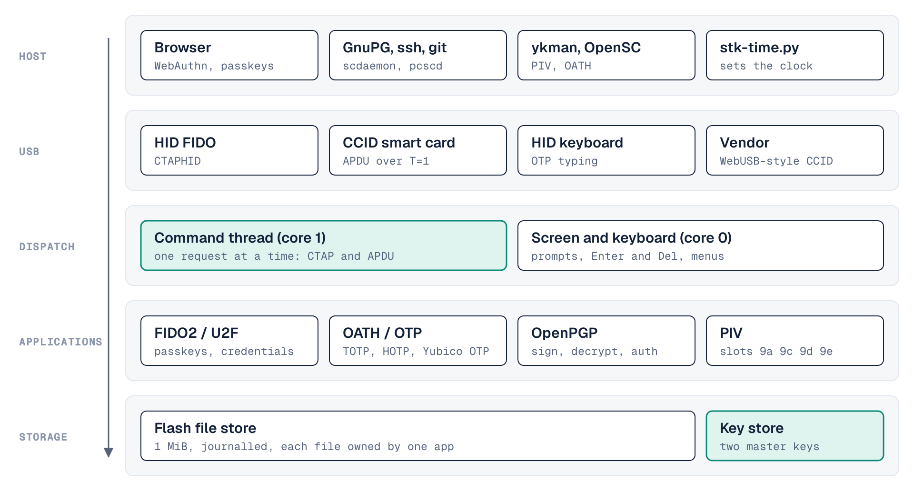

<div class="stk-hero" markdown>
<div markdown>

# A security key you can read before you approve

<p class="lead">SecTrustKey turns the M5Stack Cardputer ADV into a FIDO2 passkey, an OpenPGP smart card, a PIV card and a TOTP authenticator. Every request appears on its screen with the website and account, and nothing is signed until you press <kbd>Enter</kbd>.</p>

[Install from a release](getting-started/install.md){ .md-button .md-button--primary }
[User guide](guide/index.md){ .md-button }
[Download v1.2.0](https://github.com/TakMashhido/SecTrustKey/releases/latest){ .md-button }

</div>



</div>

<div class="stk-kpi" markdown>
<div><b>4</b><span>security applications on one key: FIDO2/U2F, OpenPGP, PIV and OATH</span></div>
<div><b>1 press</b><span>every signature, login and decryption you allow is approved on the device</span></div>
<div><b>0</b><span>keys erased by wrong passphrase tries: they only add a growing delay</span></div>
<div><b>2 min</b><span>to flash a release with esptool or the browser flasher</span></div>
</div>

## What you can do with SecTrustKey

<div class="stk-grid" markdown>
<div class="stk-card" markdown>
### :material-key-variant: Passkeys and security-key login
WebAuthn passkeys and FIDO2/U2F login with Ed25519, P-256, P-384 and P-521. The screen names the site and the account. [Passkeys →](guide/passkeys.md)
</div>
<div class="stk-card" markdown>
### :material-draw-pen: OpenPGP for GnuPG
Keys generated on the device for signing, encryption and authentication, with Curve25519, RSA, NIST, secp256k1 and Brainpool. [OpenPGP →](guide/openpgp.md)
</div>
<div class="stk-card" markdown>
### :material-console: SSH and Git signing
Use the OpenPGP authentication key for SSH and the signing key for verified Git commits. [SSH and Git →](guide/ssh-git.md)
</div>
<div class="stk-card" markdown>
### :material-timer-outline: TOTP codes on screen
Live one-time codes with a countdown; accounts that need a touch stay hidden until you press Enter. [Codes →](guide/codes.md)
</div>
<div class="stk-card" markdown>
### :material-lock-outline: Keys encrypted at rest
An optional startup passphrase seals the master keys with PBKDF2 and AES-256-GCM before USB ever starts. [Passphrase →](guide/passphrase.md)
</div>
<div class="stk-card" markdown>
### :material-sd: Encrypted microSD backup
Back up, verify and restore the whole key store. Each backup is checked twice before it replaces the last one. [Backup →](guide/backup.md)
</div>
</div>

## On the device

<div class="stk-screens" markdown>
<figure markdown>

<figcaption>Approve a sign-in on the device</figcaption>
</figure>
<figure markdown>

<figcaption>TOTP codes with a countdown</figcaption>
</figure>
<figure markdown>

<figcaption>Health check of your setup</figcaption>
</figure>
</div>

## Architecture at a glance

{ .stk-diagram }

One firmware presents four USB interfaces. Each request runs on a single command thread inside the right application, and anything sensitive waits for a key press on the screen. Read [Architecture](concepts/architecture.md) for the details.

## Flash a release

```bash
pip install esptool
# Cardputer in download mode: power off, hold G0, plug in USB, release G0
esptool.py --chip esp32s3 --baud 921600 write_flash --erase-all 0x0 sectrustkey-v1.2.0-cardputer-adv.bin
```

The full walk-through, including a backup of what is on the Cardputer now, is in [Install from a release](getting-started/install.md). Already using **M5 Launcher**? Install the same file from its SD menu and keep your other apps: [M5 Launcher and M5Burner](getting-started/launcher.md).

!!! warning "A microcontroller, not a secure element"
    Secure Boot and flash encryption are deliberately not enabled, so someone who can read the chip's flash can copy keys that are not protected by a startup passphrase. Read the [security model](concepts/security.md) and keep a second authenticator registered for every account that matters.
