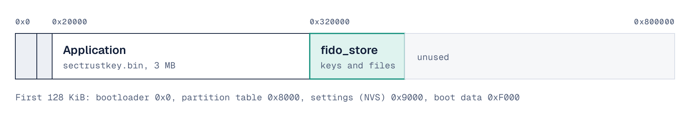

# Flash layout

{ .stk-diagram }

| Region | Offset | Size | Contents |
|---|---|---|---|
| Bootloader | `0x0` | 32 KiB | Second-stage bootloader |
| Partition table | `0x8000` | 4 KiB | This table |
| `nvs` | `0x9000` | 24 KiB | Settings (volume, brightness, timeout) |
| `otadata` | `0xF000` | 8 KiB | Boot slot selection |
| `app0` (OTA slot 0) | `0x20000` | 3 MiB | `sectrustkey.bin` |
| `fido_store` | `0x320000` | 1 MiB + 8 KiB | Two 4 KiB key-store pages, then the 1 MiB file store |
| `coredump` (debug only) | after `fido_store` | 64 KiB | Crash dump |

| Operation | Writes |
|---|---|
| Full install | Everything; `--erase-all` clears the rest |
| Update | Only `0x20000`; the key store is kept |
| SD restore | Only `fido_store` |
